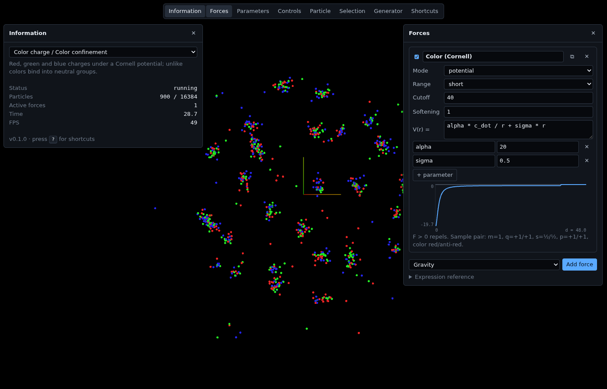

# particle.js v2



A classical n-body particle simulator that runs in the browser. You write the forces:
each one is an expression such as `k * q_i * q_j / r^2` or a potential such as
`4 * epsilon * ((sigma / r)^12 - (sigma / r)^6)`, short or long range. The expression is
compiled to GLSL and every particle pair is evaluated in parallel on the GPU.

Successor of [particle.js](https://github.com/andrenepomuceno/particle.js), rewritten from scratch.

## Features

- **Custom forces**: any number of pair forces, each with its own expression, parameters,
  range (long, or short with a cutoff) and softening. Change a parameter and the GPU picks
  it up on the next frame; change the expression and the shader is recompiled and
  validated before it replaces the old one.
- **Force or potential**: write `F(r)` directly, or write `V(r)` and get `F = −dV/dr` by
  symbolic differentiation.
- **Rich particles**: position, velocity, own clock, mass, electric charge, spin, parity, nuclear charge
  and a color charge modeled with three base vectors 120° apart, all usable in expressions.
- **Statistics**: energy, speed, temperature and performance charts.
- **Live plot** of each force as the integrator applies it (softening and cutoff included).
- **v1 look**: spheres with a velocity arrow through them, colored by charge, color charge or speed.
- **v1-style interaction**: keyboard shortcuts, draggable dialogs, click to inspect and
  edit a particle, shift+drag to select, copy and place groups, particle generator.
- **JSON scenarios**: shapes, sampled attributes, presets or custom forces, all in one file.
- **Snapshots**: export the full state (forces, settings, particles) to JSON plus a PNG,
  and import it back with field-by-field validation.
- 2D and 3D modes, sphere or box boundaries, friction, optional speed clamp.

## Quick start

Requires Node.js 22+ and a browser with WebGL2 and `EXT_color_buffer_float`.

```
npm install
npm run dev
```

Open the printed URL. Press <kbd>?</kbd> for the shortcut list. URL options:
`?scenario=quarks` picks the starting scenario, `?capacity=65536` raises the particle
limit (default 16384).

## Physics in one paragraph

Classical mechanics. For every pair, each enabled force contributes a signed magnitude
`F(r)` along the line joining the particles; **positive pushes them apart**. Short-range
forces are zero beyond their cutoff; softening ε replaces `r` with `√(r² + ε²)` inside the
expression. Particles advance with velocity Verlet (default) or semi-implicit Euler. Details: [docs/forces.md](docs/forces.md).

## Scenarios

Scenarios are JSON files in `src/scenarios/library/` (format: [docs/scenarios.md](docs/scenarios.md));
you can also load your own with <kbd>I</kbd>.

| Scenario | Forces | What to look for |
| --- | --- | --- |
| Galaxy disk | gravity | a fixed core with 3000 bodies on near-circular orbits |
| Neutral plasma | Coulomb + weak gravity | ± charges in a reflecting sphere |
| Nuclear clusters | short-range sine + Coulomb | v1's nuclear force, nucleons clumping in 2D |
| Lennard-Jones crystal | LJ potential | a cooling gas condensing into a lattice |
| Color confinement | Casimir-scaled Cornell potential, 120° color charge | quarks pairing into color-neutral mesons and baryons |
| Quarks to nuclei | color + v1 nuclear force + Coulomb + quark core | quark triplets bound into molecules and ring-shaped nuclei |
| Sandbox | gravity + Coulomb | empty; press <kbd>G</kbd> to generate particles |

## Development

```
npm run check      # typecheck + lint + unit tests
npm run smoke:all  # headless Chromium: every scenario + interaction smoke test
npm run build      # production bundle in dist/
```

Release notes: [CHANGELOG.md](CHANGELOG.md). More in [docs/development.md](docs/development.md). Documentation index: [docs/README.md](docs/README.md).

## Thanks

[three.js](https://threejs.org/) for the WebGL layer.
